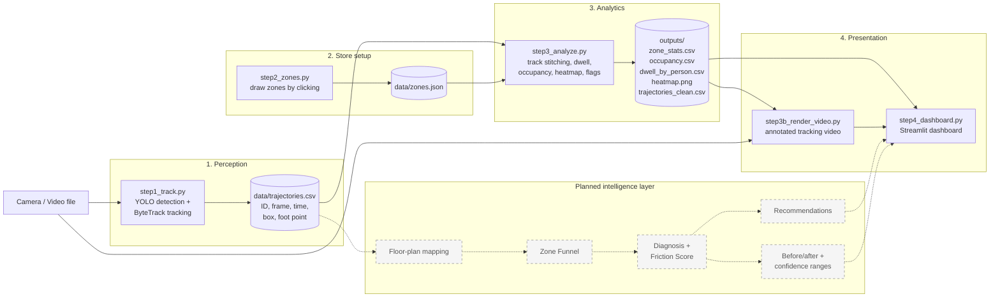

# StoreFlow AI

### Dwell-Time & Bottleneck Mapper: from CCTV to "what's wrong and what to fix"

> Other tools show **where** shoppers walk. StoreFlow AI is built to tell a store manager **why** a section is failing, **what to change**, and **whether the change worked**, using only the cameras the store already has, and without storing faces.


---

## Table of Contents

1. [Problem](#1-problem)
2. [Our Approach](#2-our-approach)
3. [Project Status](#3-project-status)
4. [System Architecture](#4-system-architecture)
5. [How It Works](#5-how-it-works)
6. [Metric Definitions](#6-metric-definitions)
7. [Quick Start (Windows + VS Code)](#7-quick-start-windows--vs-code)
8. [Project Structure](#8-project-structure)
9. [Configuration](#9-configuration)
10. [Tech Stack](#10-tech-stack)
11. [Privacy by Design](#11-privacy-by-design)
12. [Scalability](#12-scalability)
13. [Known Limitations](#13-known-limitations)
14. [Roadmap](#14-roadmap)
15. [Troubleshooting](#15-troubleshooting)
16. [Test Data](#16-test-data)
17. [Team](#17-team)

---

## 1. Problem

Physical stores cannot easily tell:

- which sections attract **long browsing**,
- which areas **block traffic**, and
- which areas are **ignored completely**.

Layout, promotional display placement and staffing therefore rely on guesswork. Most existing tools stop at heatmaps and average dwell time, which show *what* happened but not *why* or *what to do about it*.

**Challenge:** use standard in-store camera feeds to map customer journeys, generate foot-traffic heat maps, calculate section-wise dwell times, and flag layout bottlenecks or dead zones.

---

## 2. Our Approach

StoreFlow AI follows a closed loop:

```
Detect  →  Measure  →  Diagnose  →  Recommend  →  Verify
```

| Principle | What it means |
|---|---|
| **Existing cameras only** | No new hardware; works on standard CCTV footage |
| **Measure sections like web pages** | A *Zone Funnel*: pass-by → slow-down → stop → dwell |
| **Diagnose, don't just display** | Each section is classified (hot, bottleneck, ignored, dead, hesitation) |
| **Privacy first** | Only anonymous positions and times are kept: no faces, no age/gender, no stored video |
| **Honest numbers** | Accuracy is checked against manual stopwatch timing, with uncertainty reported |

---

## 3. Project Status

We label every feature as **built** or **planned**. Nothing in the "planned" column is claimed to work yet.

| Feature | Status |
|---|---|
| Person detection (YOLO) and tracking (ByteTrack) | ✅ Built and tested on sample videos |
| Foot-point trajectories with bounding boxes | ✅ Built |
| Track stitching (re-joins broken tracks, border-aware) | ✅ Built and tested |
| Zone drawing tool (click polygons on a video frame) | ✅ Built |
| Dwell time per zone (visitors, average, median, max) | ✅ Built and tested |
| Zone occupancy over time (people inside each second) | ✅ Built |
| Foot-traffic heatmap | ✅ Built |
| Bottleneck and dead-zone flags (simple rules) | ✅ Built |
| Annotated tracking video (boxes, IDs, trails, live zone counts) | ✅ Built, plays in the dashboard |
| Streamlit dashboard | ✅ Built |
| Floor-plan (top-down) mapping with real distances | 🔜 Planned |
| Zone Funnel (pass-by, slow-down, stop, dwell) | 🔜 Planned |
| Five-way zone diagnosis + Friction Score | 🔜 Planned |
| Customer journey / path analysis | 🔜 Planned |
| Plain-language recommendations | 🔜 Planned |
| Staff filtering | 🔜 Planned |
| Accuracy validation against stopwatch data | 🔜 Planned |
| Before/after layout comparison, confidence ranges | 🔜 Planned |

> **Accuracy:** We have **not yet** measured dwell-time error against ground truth. We make no accuracy claims until we have.

---

## 4. System Architecture

### 4.1 Pipeline diagram

Solid boxes are implemented. Dashed grey boxes are planned.



### 4.2 Text version (if Mermaid does not render)

```
                       ┌───────────────────────┐
                       │  Camera / video file  │
                       └───────────┬───────────┘
                                   ▼
                ┌────────────────────────────────────┐
                │ step1_track.py                     │
                │ YOLO detection + ByteTrack         │
                └───────────────┬────────────────────┘
                                ▼
                  data/trajectories.csv  ◄──────── step2_zones.py ──► data/zones.json
                                │                                          │
                                └───────────────┬──────────────────────────┘
                                                ▼
                ┌────────────────────────────────────────────────┐
                │ step3_analyze.py                               │
                │ stitch tracks · dwell · occupancy · heatmap    │
                │ bottleneck / dead-zone flags                   │
                └───────────────┬────────────────────────────────┘
                                ▼
                        outputs/*.csv, heatmap.png
                                │
              ┌─────────────────┴─────────────────┐
              ▼                                   ▼
   step3b_render_video.py              step4_dashboard.py (Streamlit)
   annotated tracking video   ───────►  heatmap · stats · alerts · video · charts

   ┄┄ planned: floor-plan mapping → funnel → diagnosis → recommendations → before/after ┄┄
```

### 4.3 Design decisions

- **Foot point, not box centre.** Where a person's feet touch the floor is the correct position for zone membership.
- **Processing at about 5 frames per second.** Enough for walking speeds, and fast on a normal computer.
- **File-based hand-offs.** Each step reads and writes plain CSV/JSON files, so steps can be run, debugged and replaced independently.
- **No database or backend server** in this version, by design, to keep it simple and portable.

---

## 5. How It Works

### Step 1: Detect and track (`step1_track.py`)
Reads the video, runs YOLO person detection and ByteTrack on every processed frame, and writes one row per person per frame: ID, frame, time, bounding box and foot point. Tracker settings in `tracker.yaml` keep a hidden person's ID alive for about 12 seconds and create fewer ghost IDs.

### Step 2: Define zones (`step2_zones.py`)
You click polygon corners on a frame of your video, press `N` to finish a zone and name it in the terminal, then `S` to save. Zones are stored as pixel polygons in `data/zones.json`.

### Step 3: Analyze (`step3_analyze.py`)
1. **Track stitching:** The tracker sometimes loses a person behind a shelf and gives them a new ID. We join a track that ends to a track that starts shortly after and nearby (distance measured in person-heights). We never stitch at the frame edge, so one person leaving and another entering at a door are not merged.
2. **Cleaning:** Tracks shorter than 1 second are removed.
3. **Dwell time:** For each zone, we add up the time slices each person spent inside the polygon.
4. **Occupancy:** We count distinct people inside each zone every second.
5. **Flags:** Simple rules label each zone (see section 6).
6. **Heatmap:** Time spent at each spot is accumulated, blurred, coloured and overlaid on the reference frame.

### Step 3b: Render (`step3b_render_video.py`)
Re-draws the video with a box and ID for each person, a short walking trail, zones coloured by status, and a live count of people inside each zone. Boxes are interpolated between processed frames so motion looks smooth. The output is H.264 so it plays in any browser.

### Step 4: Dashboard (`step4_dashboard.py`)
Shows headline numbers, the tracking video, heatmap, zone table, alerts, dwell and visitor charts, and people-per-zone over time.

---

## 6. Metric Definitions

| Metric | Definition |
|---|---|
| **Visitor (of a zone)** | A person who spent at least `MIN_VISIT_SEC` (1 s) inside the zone |
| **Dwell time** | Total time a visitor spent inside the zone's polygon |
| **Visitor share** | Visitors of the zone ÷ all tracked people |
| **Peak people at once** | Highest number of distinct people inside the zone in any one second |
| **Crowded seconds** | Longest unbroken stretch with at least `CROWD_PEOPLE` (5) people inside |
| **Bottleneck flag** | Crowded seconds ≥ `CROWD_SECONDS` (10) |
| **Dead zone flag** | Visitor share < `DEAD_ZONE_SHARE` (10%), checked only if not a bottleneck |
| **OK** | Neither of the above |

> These thresholds are starting points. They depend on zone size and camera view, and must be tuned per store. The current bottleneck rule counts people, so it is sensitive to zone size. A density-based rule (people per m²) comes with the floor-plan upgrade.

---

## 7. Quick Start (Windows + VS Code)

**Requirements:** Python 3.12 (64-bit) with "Add python.exe to PATH" ticked at install, and VS Code.

### 7.1 Set up

```powershell
# in the project folder, inside the VS Code terminal
python -m venv venv
.\venv\Scripts\Activate.ps1
pip install -r requirements.txt
```

If PowerShell blocks activation, run once:
```powershell
Set-ExecutionPolicy -Scope CurrentUser -ExecutionPolicy RemoteSigned
```

> The first install is large because YOLO brings PyTorch. The YOLO model downloads automatically on first run.

### 7.2 Run on your own video

```powershell
python step1_track.py --video your_video.mp4       # 1. detect and track
python step2_zones.py                              # 2. draw zones (click, N, name, S)
python step3_analyze.py                            # 3. analytics
python step3b_render_video.py --video your_video.mp4   # 3b. tracking video
streamlit run step4_dashboard.py                   # 4. dashboard
```

Use the **same video file** in steps 1 and 3b. Press `Ctrl + C` in the terminal to stop the dashboard.

### 7.3 Try it without a video (demo data)

```powershell
python make_demo_data.py
python step3_analyze.py
streamlit run step4_dashboard.py
```

This creates **fake** shoppers for testing only. Never present demo results as real findings.

### 7.4 Useful options for step 1

| Option | Default | Use |
|---|---|---|
| `--model` | `yolov8s.pt` | `yolov8n.pt` is faster, `yolov8m.pt` is more accurate |
| `--imgsz` | `960` | Larger helps find small or distant people (slower) |
| `--fps` | `5` | Frames per second to process |
| `--conf` | `0.3` | Minimum detection confidence |
| `--tracker` | `tracker.yaml` | Or `botsort.yaml` |

---

## 8. Project Structure

```
StoreFlow-AI/
├── step1_track.py            # video → trajectories.csv
├── step2_zones.py            # draw zones → zones.json
├── step3_analyze.py          # analytics, heatmap, flags
├── step3b_render_video.py    # annotated tracking video
├── step4_dashboard.py        # Streamlit dashboard
├── make_demo_data.py         # optional: fake data for testing
├── tracker.yaml              # ByteTrack settings tuned for stores
├── requirements.txt
├── README.md
├── data/                     # created by the scripts
│   ├── trajectories.csv
│   ├── reference_frame.jpg
│   └── zones.json
└── outputs/                  # created by the scripts
    ├── trajectories_clean.csv
    ├── zone_stats.csv
    ├── occupancy.csv
    ├── dwell_by_person.csv
    ├── summary.json
    ├── heatmap.png
    └── tracking_video.mp4
```

### Data formats

**`data/trajectories.csv`**

| Column | Meaning |
|---|---|
| `track_id` | ID given by the tracker |
| `frame`, `t_sec` | Frame number and time in seconds |
| `x_px`, `y_px` | Foot point in pixels |
| `conf` | Detection confidence |
| `x1`, `y1`, `x2`, `y2` | Bounding box |

**`data/zones.json`**
```json
[{ "name": "Electronics", "polygon": [[700,150],[980,150],[980,300],[700,300]] }]
```

---

## 9. Configuration

Analytics thresholds are at the top of `step3_analyze.py`:

| Setting | Default | Meaning |
|---|---|---|
| `MIN_TRACK_SEC` | 1.0 | Ignore tracks shorter than this |
| `MIN_VISIT_SEC` | 1.0 | Minimum time in a zone to count as a visitor |
| `DEAD_ZONE_SHARE` | 0.10 | Below this visitor share = dead zone |
| `CROWD_PEOPLE` | 5 | People at once that count as crowded |
| `CROWD_SECONDS` | 10 | How long crowding must last to flag a bottleneck |
| `OCC_BIN_SEC` | 1.0 | Occupancy counting interval |
| `STITCH` | True | Re-join broken tracks |
| `STITCH_MAX_GAP_SEC` | 4.0 | Longest disappearance allowed when stitching |

---

## 10. Tech Stack

| Area | Tools |
|---|---|
| Language | Python 3.12 |
| Detection and tracking | Ultralytics YOLO, ByteTrack |
| Video and image processing | OpenCV, NumPy |
| Data handling | pandas |
| Video encoding | imageio-ffmpeg (H.264, no separate ffmpeg install) |
| Dashboard | Streamlit |

---

## 11. Privacy by Design

- Only **anonymous positions and times** are kept.
- **No facial recognition**, and no age or gender estimation.
- Raw video does not need to be stored after processing.
- Track IDs are temporary labels, not identities.

This keeps the system simpler to approve in real stores. Anyone deploying it should still follow local privacy law and post appropriate notices.

---

## 12. Scalability

This describes the **design**. We have not load-tested many cameras.

- Works from **existing cameras**, so no new hardware is needed.
- Processes about **5 frames per second**, which fits a standard computer.
- Each camera is processed **independently**, so scaling means running more parallel copies.
- **Small outputs:** CSV and JSON tables instead of hours of video.
- Zones and thresholds are **plain files**, so onboarding a new store means a one-time setup, not new code.

---

## 13. Known Limitations

- **Heatmaps and distances are in camera pixels.** Perspective distorts them until the floor-plan mapping is added.
- **Bottleneck detection is basic.** It counts people and depends on zone size.
- **"Dead zone" currently also covers "ignored".** The pass-by measurement that separates them is planned.
- **Tracking can lose people** in crowds or behind shelves. Stitching helps but is deliberately cautious, so some splits remain.
- **Overhead or very close wide-angle views** can give loose bounding boxes. Best results come from a fixed camera that sees whole bodies.
- **No validation yet** against manual stopwatch timing.
- **Thresholds need tuning** per store and camera view.
- **Staff are not filtered**, so they count as customers.

---

## 14. Roadmap

- [x] Detection, tracking, trajectories
- [x] Track stitching
- [x] Zones, dwell time, occupancy, heatmap, basic flags
- [x] Tracking video and dashboard
- [ ] Floor-plan mapping (homography) and density in people per m²
- [ ] Zone Funnel: pass-by → slow-down → stop → dwell
- [ ] Diagnosis: hot, bottleneck, ignored, dead, hesitation + Friction Score
- [ ] Customer journeys and most common paths
- [ ] Plain-language recommendations
- [ ] Staff filtering
- [ ] Validation against stopwatch ground truth, with confidence ranges
- [ ] Before/after layout comparison
- [ ] Queue wait-time estimate and abandonment detection
- [ ] Multi-camera stitching, time-of-day comparison, what-if layout simulator

---

## 15. Troubleshooting

| Problem | Fix |
|---|---|
| `'python' is not recognized` | Reinstall Python with "Add python.exe to PATH" ticked; reopen VS Code |
| PowerShell blocks `Activate.ps1` | Run the `Set-ExecutionPolicy` command in section 7.1 |
| `ModuleNotFoundError` | Check `(venv)` shows in the terminal, then `pip install -r requirements.txt` |
| "trajectories.csv is from an older version" | Re-run `step1_track.py` (it now saves bounding boxes) |
| Zones show 0 visitors | Draw zones on the **floor where people stand**, not on the shelf; delete `data/zones.json` and redo |
| Zone window looks frozen | After pressing `N`, type the zone name in the **terminal**, then press Enter |
| Dashboard shows "No tracking video yet" | Run `step3b_render_video.py` |
| Video does not play in the dashboard | Re-run `step3b_render_video.py` (it writes browser-compatible H.264) |
| Step 1 is very slow | Use `--model yolov8n.pt`, or lower `--imgsz` / `--fps` |
| People count looks too high | Check the tracking video for ID changes on one person; consider a larger `STITCH_MAX_GAP_SEC` |
| Page does not open | Go to `http://localhost:8501` in your browser |

---

## 16. Test Data

Use **fixed-camera** footage with whole bodies visible, no cuts or zooms, and not too crowded.

- **Your own staged clip (recommended):** film with permission from a high, fixed position for 5 to 10 minutes.
- **Public datasets:** MOTChallenge (MOT20) for tracking stress tests; Hugging Face hosts retail-related datasets. Check each licence before use.
- **Stock video sites** (Pexels, Pixabay): fixed-camera clips; check each clip's licence.

Always state the source of your footage in any presentation. Demo data from `make_demo_data.py` is synthetic.

---

## 17. Team

| Name | Role |
|---|---|
| Rohan | *add role* |
| Shourya | *add role* |
| Harshad | *add role* |
| Anurag | *add role* |

---

*StoreFlow AI turns the cameras stores already own into decisions.*
